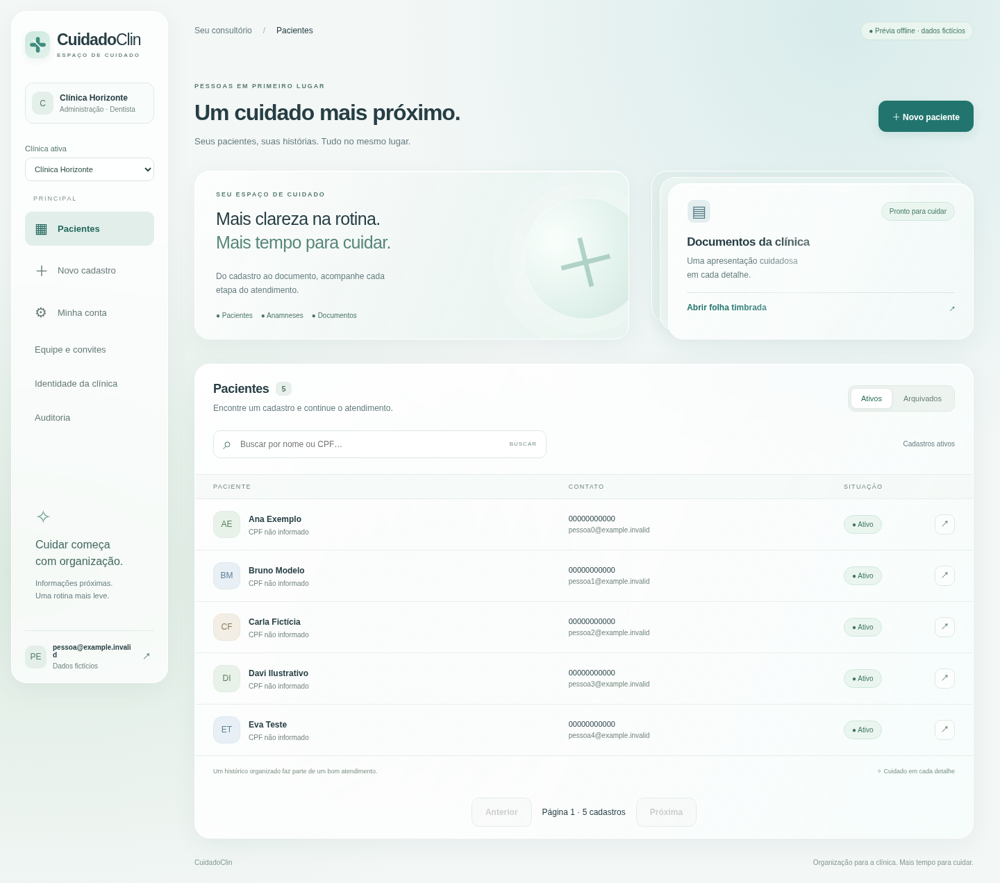
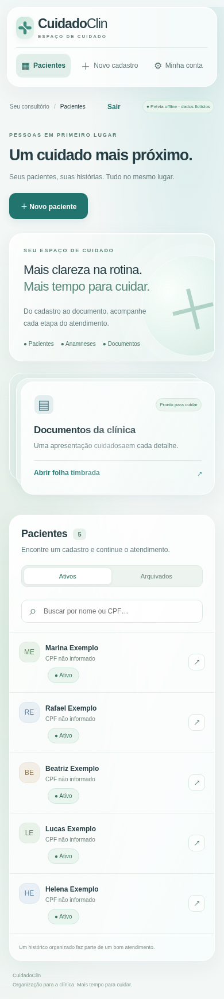

# CuidadoClin
### Organização para a clínica. Mais tempo para cuidar.

**Pacientes · Anamnese · Equipe · Documentos personalizados**

Case de uma aplicação odontológica em evolução para um SaaS multi-clínicas.

[Projeto](docs/projeto.md) · [Demonstração](docs/demonstracao.md) · [Arquitetura](docs/arquitetura.md) · [Decisões](docs/decisoes.md) · [Evolução](docs/evolucao.md)

Superfícies claras, verde-água e cartões de vidro fosco organizam a rotina. A clínica ativa aparece na navegação; cada pessoa encontra as ações permitidas pelo seu vínculo.

Veja o visual no celular

**Todas as capturas são de uma demonstração offline com dados fictícios.** Este repositório contém somente documentação e imagens: não distribui código, aplicativo executável, credenciais ou acesso a clientes.

## Do consultório ao produto

O projeto começou com pacientes, anamneses e PDFs de uma clínica odontológica. A evolução mantém esses fluxos e acrescenta contas individuais, equipe, permissões e separação dos dados entre organizações, com uma única base de código.

## Estado do projeto

A implementação SaaS foi revisada e exercitada em ambiente local com PostgreSQL e dados sintéticos. **A migração SaaS em produção ainda está pendente.** A versão publicada recebeu o novo visual e conserva o modelo anterior de conta única.

| Recurso | Estado da implementação SaaS |
| --- | --- |
| Contas individuais, sessões e seleção de clínica | Implementado e testado localmente |
| Administrador, dentista e recepção | Permissões por vínculo, verificadas no servidor |
| Cadastro, busca, histórico e arquivamento | Implementados, com paginação e cadastro separado da anamnese |
| Equipe, convites e recuperação | Implementados; entrega real de e-mail depende de configuração e validação |
| Isolamento no banco | PostgreSQL RLS e papel restrito, ensaiados localmente |
| Cinco tipos de PDF | Emitente autorizado e modelos privados por clínica/profissional |
| Preservação do legado | Migração e comparação visual ensaiadas com dados sintéticos |

## Decisões que orientam a engenharia

- Código compartilhado; acesso determinado por usuário, clínica e permissão.
- Administrador não recebe acesso clínico automaticamente.
- Trocar de clínica limpa formulários e documentos e descarta respostas atrasadas.
- Cadastro e anamnese são etapas independentes: uma falha clínica não duplica o paciente.
- Documentos pessoais permanecem exclusivos de seu profissional; outras clínicas usam identidade própria.
- Demonstração e produção usam adaptadores separados; nenhum dado real entra no portfólio.

## Tecnologia e validação

React, Vite e React Router na interface; Node.js/Express na API; PostgreSQL; sessões opacas em cookie HttpOnly, CSRF e bcrypt; geração de PDFs com pdf-lib.

Os ensaios incluem permissões, isolamento entre clínicas, concorrência de convites, recuperação de backup e PDFs. As jornadas de navegador usam dados sintéticos e verificam cadastro, troca de clínica, documentos e logout. Isso não equivale a uma auditoria ou certificação de produção.

[Leia os limites e a próxima etapa de publicação →](docs/evolucao.md)

## Autoria

Projeto apresentado por [dev-alef](https://github.com/dev-alef). Código privado; case público documental. Estado documentado em **4 de novembro de 2026**.
