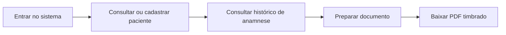

# CuidadoClin
### Organização para a clínica. Mais tempo para cuidar.

**Gestão de pacientes · Histórico de anamnese · Documentos personalizados**

Case de desenvolvimento de uma aplicação odontológica em evolução para SaaS.

[O projeto](docs/projeto.md) · [Demonstração fictícia](docs/demonstracao.md) · [Arquitetura](docs/arquitetura.md) · [Decisões](docs/decisoes.md) · [Evolução](docs/evolucao.md)

---

## O problema

Organizar o cadastro de pacientes, consultar informações de anamnese e preparar documentos faz parte da rotina de um consultório. O CuidadoClin reúne esses fluxos em uma aplicação web e preserva a identidade visual dos documentos da clínica.

O projeto parte de uma aplicação para uma clínica odontológica. A próxima etapa é permitir que pequenas clínicas utilizem o mesmo produto com contas individuais, permissões e dados separados por organização.

## O que existe hoje

| Recurso | Estado da base atual |
| --- | --- |
| Login, troca de senha e encerramento de sessão | Implementado para conta administrativa única |
| Cadastro, edição e consulta de pacientes | Implementado |
| Arquivamento e restauração de pacientes | Implementado |
| Registro e histórico de anamnese | Implementado |
| Ficha, atestado, orçamento, receituário e folha timbrada em PDF | Implementado |
| Identidade personalizada nos documentos | Modelo específico da clínica de origem |
| Contas individuais, permissões e múltiplas clínicas | Planejado |
| Identidade visual e modelo de PDF por clínica | Planejado |

**Este repositório é uma apresentação documental.** Não contém o código-fonte da aplicação, um aplicativo executável ou acesso ao ambiente de clientes. Os cenários de demonstração são integralmente fictícios. A evolução multi-clínicas ainda não foi implementada na base apresentada.

## Percurso principal

[Explore um atendimento fictício e exemplos de dados →](docs/demonstracao.md)

## Tecnologia

| Camada | Tecnologia |
| --- | --- |
| Interface | React 19, Vite e React Router |
| API | Node.js e Express |
| Persistência | PostgreSQL |
| Autenticação | JWT e bcrypt |
| Documentos | pdf-lib |
| Verificação | Test runner nativo do Node e lint do frontend |

## Destaques de engenharia

- Separação entre interface, API e persistência.
- Documentos obtidos por requisições autenticadas, sem credenciais na URL.
- Revogação de sessões associada à conta e limites de tentativas persistidos no banco.
- Migrações versionadas com verificação de integridade e aplicação transacional.
- Planejamento da transição para múltiplas clínicas sem perder a personalização existente.

Esses pontos descrevem a base de código inspecionada; não constituem auditoria de produção, certificação ou garantia de conformidade.

## Próxima versão

O primeiro público será formado por consultórios e pequenas clínicas odontológicas. A base compartilhada incluirá usuários, clínicas, permissões e identidade visual por clínica. Outras especialidades serão incorporadas gradualmente.

[Veja o que está confirmado e o que ainda precisa ser definido →](docs/evolucao.md)

## Autoria

Projeto apresentado por [dev-alef](https://github.com/dev-alef).

O código da aplicação é privado. Este repositório reúne exclusivamente documentação e exemplos preparados para portfólio. Estado documentado em **1 de novembro de 2026**.
