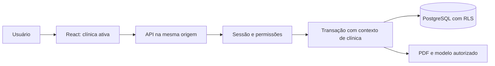

# Arquitetura

A identidade vem da sessão opaca em cookie HttpOnly. Mutações exigem CSRF e origem autorizada. O identificador de clínica enviado pelo navegador é validado contra o vínculo ativo; papéis enviados pelo cliente não concedem acesso.

As consultas incluem a clínica, e políticas RLS restringem os registros no PostgreSQL. O contexto é local à transação, na mesma conexão, e o papel de execução não é administrador do banco. Chaves estrangeiras compostas impedem associações clínicas cruzadas.

Na interface, trocar de clínica cancela requisições, descarta respostas atrasadas e limpa formulários e PDFs. O cadastro básico é separado da informação clínica; a recepção recebe respostas sem anamnese ou observações clínicas.

Os documentos usam o próprio perfil profissional autorizado. Modelos pessoais são vinculados ao profissional; modelos institucionais recebem sua identificação na emissão. Publicação de modelos é assistida, privada e versionada.

Essa arquitetura está implementada e ensaiada localmente; validação do proxy e dos cookies na hospedagem e migração de produção ainda são etapas de publicação.
