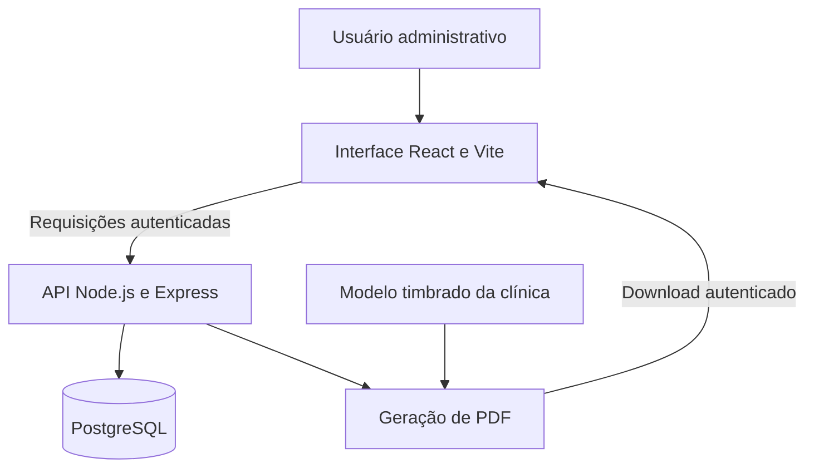

# Arquitetura e limites

## Base existente

A interface apresenta os fluxos de pacientes e documentos. A API verifica autenticação, acessa o PostgreSQL e prepara os PDFs. O modelo visual dos documentos ainda é global para a clínica de origem.

## Organização do desenvolvimento

O projeto mantém interface, API e site institucional em um repositório privado, com aplicações e dependências separadas. A apresentação pública tem histórico independente e não distribui o repositório da aplicação.

## Controles presentes na base

- Senhas verificadas por hash bcrypt e acesso por token JWT.
- Revogação de sessões por versão de token da conta administrativa.
- Limites de tentativas de autenticação persistidos no PostgreSQL.
- Validação de identificadores antes de consultas privadas.
- PDFs recebidos pelo frontend por requisição autenticada.
- Migrações versionadas com checksum, transação e controle de concorrência.

A base atual ainda não implementa autorização por clínica. Autenticação, por si só, não representa isolamento entre organizações.

## Evolução confirmada

O produto deverá representar usuários, clínicas e suas associações, aplicar permissões e selecionar a identidade da clínica para os documentos. O mecanismo de isolamento no banco, o modelo de sessão, os papéis iniciais e a estratégia de migração ainda serão definidos no plano técnico.

## Validação

O projeto possui suites para autenticação, migrações, configuração TLS, downloads e sessão, além de um procedimento local de recuperação com dados fictícios. Esta publicação documental não executou novamente essas suites nem comprova a configuração de produção.

Antes do lançamento multi-clínicas, será necessário demonstrar isolamento de leitura e escrita, revogação de acesso, recuperação de dados e preservação visual dos documentos personalizados.
